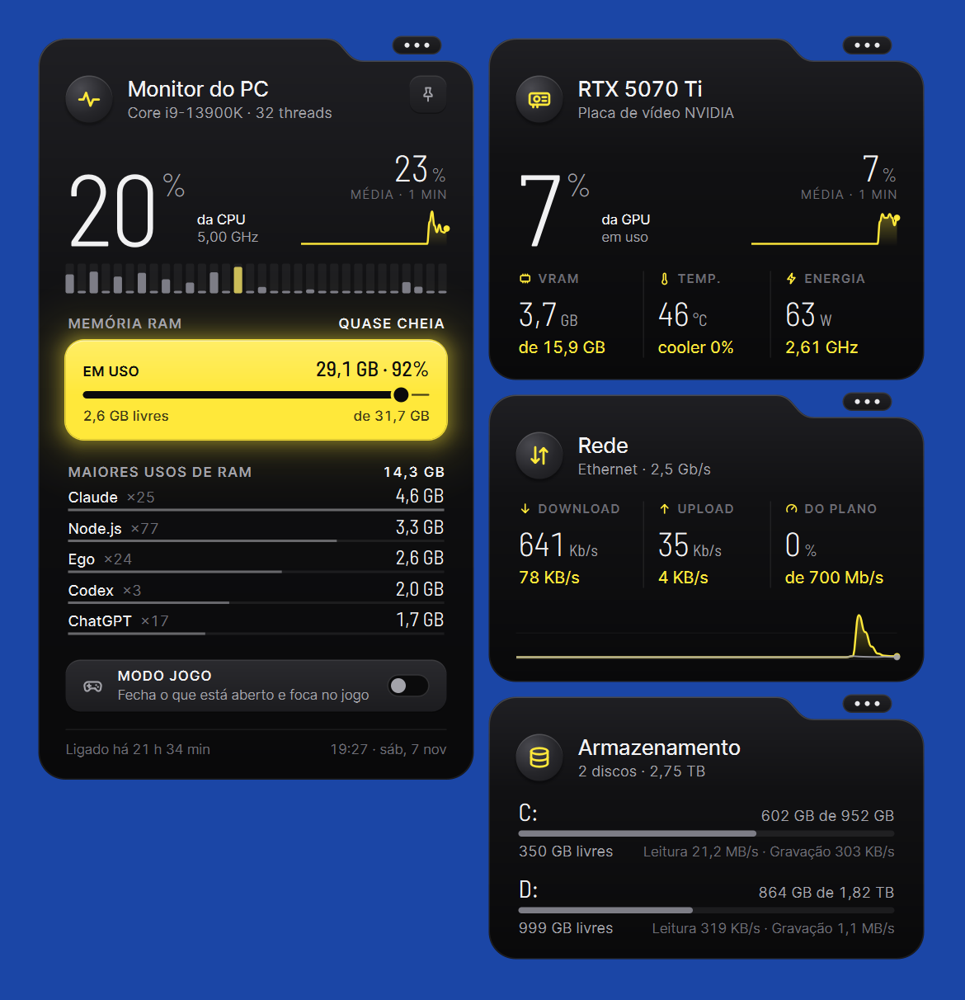
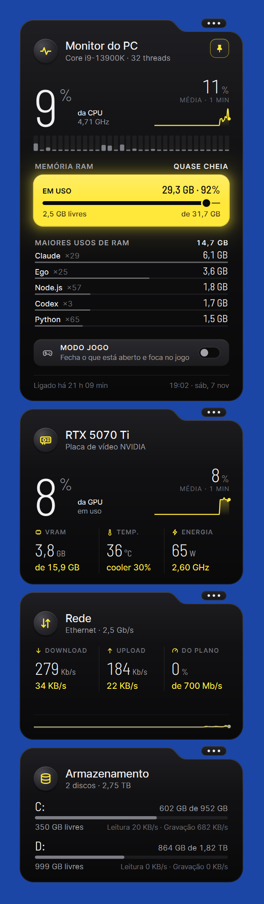

<h1 align="center">CorePulse</h1>

<p align="center">
  <b>Monitor de recursos para a área de trabalho do Windows 11, em cards pretos com um painel neon.</b><br>
  CPU, memória, GPU NVIDIA, rede e discos em tempo real — bonito, leve e sem poluir a barra de tarefas.
</p>

<p align="center">
  
  
  
  
</p>

<p align="center">
  
</p>

> **English:** CorePulse is a featherlight system-monitor widget for the Windows 11 desktop
> (black folder-shaped cards, thin condensed numbers and one yellow neon panel). Live CPU / per-core, RAM, NVIDIA GPU (NVML), network and
> disk usage in ~26 MB of RAM and ~0.2 % of total CPU. The interface is in Brazilian Portuguese.

## Destaques

- **Visual novo:** cards pretos em formato de pasta com "•••" no recorte, números grandes em Barlow Semi Condensed Light, rótulos pequenos em caixa alta e **um** painel neon amarelo (`#ffe83a`) para a memória. Sem sombra nem halo em volta: só a borda de 1 px (detalhes em [Visual](#visual)).
- **Nunca cobre seus apps:** por padrão o widget fica atrás de todos os apps, logo acima da área de trabalho, mesmo depois de clicar nele ou arrastá-lo. Aberto de propósito (ícone da bandeja ou abrindo o atalho de novo), aparece na frente até você clicar em outra janela e então volta para trás. Sem botão na barra de tarefas e fora do Alt+Tab.
- **Fixar (alfinete):** desligado por padrão. Ligado, deixa o widget sempre por cima das janelas; jogo em tela cheia no mesmo monitor tem prioridade (o widget sai de cima e volta quando o jogo fecha).
- **Sempre visível:** arraste segurando em qualquer parte do card (fora dos botões); ele fica inteiro dentro do monitor onde está o cursor. Ao abrir, ao mudar de tamanho e quando um monitor desliga ou muda de resolução/escala, volta para dentro de um monitor visível. A parte transparente da janela não pega clique.
- **Multi-monitor:** escolha o monitor e o canto pelo menu (ou arraste — ele "gruda" nas bordas). Layout em **coluna** (ideal para monitor vertical) ou **painel largo**.
- **Números que batem com o Gerenciador de Tarefas:** usa os mesmos contadores do Windows (PDH) — uso de CPU "Processor Utility", memória "Em uso", rede e atividade de disco.
- **Leve de verdade:** ~26 MB de RAM (≈16 MB na coluna *Memória* do Gerenciador), ~0,2 % da CPU total. Prioridade abaixo do normal, sem timers de 1 ms, e **para de pintar** quando um jogo/app em tela cheia cobre o widget.
- **Animações suaves:** gráficos que deslizam, barras e números que "rolam" a cada amostra e depois o widget fica parado.

### O que mostra

| Bloco | Detalhes |
|---|---|
| **CPU** | uso total, histórico de 1 min, uma barra por núcleo/thread, frequência real |
| **Memória** | usada / total / livre e % |
| **GPU NVIDIA** | uso, VRAM (igual ao `nvidia-smi`), temperatura, potência, clock — via NVML, sem chamar o `nvidia-smi` |
| **Rede** | download e upload em Mb/s e MB/s, histórico, % do seu plano — só adaptadores físicos |
| **Armazenamento** | todos os discos fixos: usado / livre e leitura/gravação ao vivo |
| **Maiores usos de RAM** | por programa (conjunto de trabalho privado, como o Gerenciador) e tempo ligado |

Tudo fica cinza no uso normal; barras de núcleos e discos acendem no neon acima de ~80 %, e o painel da memória avisa "alta" / "quase cheia".

### Layouts

As capturas abaixo usam dados fictícios de demonstração (`python ferramentas/gerar_capturas.py`).

<p align="center">
  
  &nbsp;&nbsp;
  
</p>

## Visual

O widget segue o mesmo guia de estilo dos outros widgets de área de trabalho do autor. O essencial:

- **Cards em formato de pasta:** pretos (`#1f1f23 → #111113 → #09090a`), cantos de 22 px, uma aba mais alta à
  esquerda e um recorte no canto direito com "•••", que abre o menu. Borda de 1 px e nenhuma sombra ou halo
  em volta.
- **Tipografia:** números em Barlow Semi Condensed Light, finos e condensados (o principal de cada card
  bem grande, os das estatísticas menores); rótulos pequenos em caixa alta e textos em Inter. Texto em
  `#f1f1f2`, `#a3a3aa` e `#6c6c74`.
- **Um neon só:** cada widget tem uma cor, e este é o **amarelo `#ffe83a`**. Ela aparece em um único painel
  (aqui, a memória), com brilho que fica dentro do card. O resto é cinza e só acende no neon quando passa de
  ~80 %.
- **Ícones em traço** (SVG), na mesma espessura do texto.

Não há mais temas de cores; o campo `"tema"` do `config.json` só escolhe a arte do ícone da bandeja
(arquivos em [`temas/`](temas/)).

## Instalação

Requisitos: **Windows 11**, **Python 3.12+** (com `pythonw.exe`). Placa NVIDIA é opcional (sem ela, o bloco de GPU some).

```powershell
git clone https://github.com/kaykyoncode/corepulse.git
cd corepulse
.\instalar.ps1
```

O `instalar.ps1` instala as dependências **dentro do projeto** (`.libs`, nada global), gera o ícone e cria
os atalhos: um na pasta de inicialização do Windows (para abrir no logon) e um na sua área de trabalho
(ou em `Desktop\05 Atalhos`, se essa pasta existir). Use `-SemInicio` para não iniciar com o Windows.

Para abrir agora: dê dois cliques no atalho **CorePulse** ou rode `pythonw corepulse.pyw`.

Ao atualizar uma instalação anterior, feche o widget antes de executar `instalar.ps1`.
As preferências e o estado do Modo Jogo migram automaticamente para `%APPDATA%\CorePulse`
se a pasta nova ainda não existir. O instalador substitui os atalhos antigos nos locais em que cria
os novos. A primeira ativação do Modo Jogo após a mudança de nome pode pedir permissão de administrador
para registrar `\CorePulse\Modo Jogo` e remover a tarefa anterior.

## Uso

| Ação | Como |
|---|---|
| Mover | segure em qualquer parte de um card (fora dos botões) e arraste; a posição fica salva e ele não sai da tela |
| Fixar sobre as janelas | alfinete no cabeçalho, ou menu → *Fixar sobre outras janelas* (desligado por padrão; ao soltar, aparece "Atrás dos seus apps de novo.") |
| Monitor / canto / layout | "•••" no topo de qualquer card, clique direito no widget ou no ícone da bandeja |
| Travar posição | menu → *Travar posição* |
| Ver por cima dos apps / ocultar | clique esquerdo no ícone da bandeja: o 1º clique traz o widget para a frente (até você clicar em outra janela), o seguinte oculta |
| Fechar | menu → **Sair** ou `pythonw corepulse.pyw --sair` |
| Iniciar com o Windows | menu → *Iniciar com o Windows* |
| Modo Jogo | botão logo abaixo do cabeçalho, menu → *Ativar Modo Jogo* ou `pythonw corepulse.pyw --modo-jogo` |

Configuração em `%APPDATA%\CorePulse\config.json` (a maior parte pelo menu). O campo `"versao"` marca as
migrações já feitas (a 2 desligou uma vez o alfinete de quem o tinha ligado só por ser o padrão antigo). Um campo só existe no arquivo:
`"plano_mbps"` — a velocidade contratada, em Mb/s, para o "% do plano" da rede (`0` esconde). Erros vão para `%APPDATA%\CorePulse\erro.log`.

## Modo Jogo

Um clique fecha o que está aberto e deixa o PC só para o jogo; outro clique devolve tudo como estava.

**Ao ativar**

- Mostra a lista do que está aberto, um item por app, com a RAM de cada um. Marcado = vai fechar. Launchers
  (Steam, Epic, Riot…) e jogos abertos vêm desmarcados. As escolhas ficam salvas, e dá para ativar direto
  nas próximas vezes (menu → *Modo Jogo: mostrar a lista antes de ativar*).
- Fecha como o X da janela. App que só some para a bandeja é encerrado; **app que pergunta se quer salvar
  continua aberto** (e aparece no aviso).
- Nunca fecha: Windows, drivers, áudio, NVIDIA/AMD/Intel, periféricos (G HUB, Options+, Razer, Corsair…),
  antivírus, antitrapaça, nem os ajudantes deles. Só mexe no que é do seu usuário.
- Pausa serviços em segundo plano: Windows Update, indexação, SysMain, telemetria, Otimização de Entrega,
  spooler e atualizadores (lista em `src/corepulse/modo_jogo_admin.py`).
- Energia em **Desempenho Máximo** (criado na 1ª vez), Modo de Jogo do Windows e *Otimizações para jogos em
  janela* ligados, memória em espera esvaziada e prioridade acima do normal para o jogo em tela cheia.
- WSL / Docker, se marcados, são desligados (`wsl --shutdown`).
- Apps abertos **depois** de ativar nunca são tocados.

**Ao desativar:** os serviços voltam, o plano de energia e o registro voltam ao que eram, o jogo volta à
prioridade normal e os apps fechados reabrem (os que tinham janela, os que abrem com o Windows e o papel de
parede animado; scripts e terminais não).

**Administrador:** na 1ª ativação o Windows pede permissão uma vez. O CorePulse cria a tarefa agendada
`\CorePulse\Modo Jogo` (elevada) e daí em diante liga e desliga sem UAC. Para remover a tarefa, num terminal
como administrador: `schtasks /Delete /TN "\CorePulse\Modo Jogo" /F`.

**Segurança:** o estado vai para `%APPDATA%\CorePulse\modo_jogo\estado.json` antes de fechar qualquer coisa.
Se o PC reiniciar com o Modo Jogo ligado, o widget devolve o plano de energia sozinho ao abrir (os serviços
já voltam com o Windows). Para ver o que seria feito, sem fazer nada: `python corepulse.pyw --modo-jogo-simular`.

## Como funciona

- **Métricas:** PDH (`Processor Information`, `Network Interface`, `PhysicalDisk`), NVML por `ctypes` (`nvmlDeviceGetMemoryInfo_v2`, igual ao `nvidia-smi`) e Toolhelp + `PrivateWorkingSetSize` para os processos. `psutil` cobre RAM, discos e o plano B.
- **Janela:** transparente por pixel (janela *layered*: o que é transparente não pega clique), sem cantos/borda/sombra do DWM; estilo `WS_EX_TOOLWINDOW | WS_EX_NOACTIVATE`.
- **Ordem das janelas:** solta (padrão), recebe `SetWindowPos(HWND_BOTTOM, … SWP_NOACTIVATE | SWP_NOOWNERZORDER)` ao abrir, ao ser ativada, no fim do arraste, depois de um menu e ao soltar o alfinete; além disso, qualquer outra mudança de Z-order que o Windows ou o Qt pedirem é trocada por `HWND_BOTTOM` em `WM_WINDOWPOSCHANGING`. O Explorer mantém a área de trabalho (Progman) no fundo, então o widget fica logo acima dela; Progman também é a *dona* da janela, para ela acompanhar o Win+D. Fixada: `HWND_TOPMOST`; ao soltar, `HWND_NOTOPMOST` e depois `HWND_BOTTOM`. Para aparecer na frente sem ficar "sempre por cima", liga e desliga o `HWND_TOPMOST` (um `HWND_TOP` vindo de um processo em segundo plano não passa da janela em foco), tenta pegar o foco e volta para o fundo quando o foco vai para outra janela.
- **Pintura em camadas:** os cards, ícones e o painel neon ficam num `QPixmap` refeito só quando o layout ou a escala do monitor mudam; os textos, num segundo `QPixmap` refeito a cada amostra (1×/s); números grandes, gráficos e barras são desenhados por cima a 25 fps só durante ~0,7 s após cada amostra. O brilho do neon é uma curva gaussiana (como um `box-shadow`) desenhada em retângulos concêntricos e recortada pelo contorno do card.
- **Sempre na tela:** o arraste usa a área útil do monitor sob o cursor e a janela tem tamanho em múltiplos de 4 px, para não sobrar meio pixel fora da borda a 125/150/175 %. Uma checagem depois de cada movimento, outra a cada 3 s e os sinais de monitor ligado/desligado e de mudança de resolução ou escala trazem o widget de volta se ele ficar fora. Se o layout escolhido não couber no monitor, ele troca sozinho entre coluna e painel.
- **Robustez:** instância única (mutex), watchdog que se relança se o Explorer reiniciar, `--sair` fecha a instância em execução.

Estrutura: `corepulse.pyw` (entrada) · `src/corepulse/` (`coletores.py`, `widget.py`, `temas.py`, `winapi.py`, `app.py`, `config.py`, `icone.py`, `modo_jogo.py`, `modo_jogo_admin.py`, `modo_jogo_ui.py`) · `temas/` · `assets/` · `fontes/` · `ferramentas/gerar_icone.py` · `instalar.ps1`.

## Limitações e ideias

- **Temperatura da CPU não aparece:** no Windows só dá para ler com driver de kernel (ex.: LibreHardwareMonitor, como administrador). Fica como possível extensão opcional.
- GPU: só NVIDIA por enquanto (AMD/Intel Arc seriam um novo coletor).
- Com o alfinete desligado, o comportamento com **Win+D** depende da janela ser "dona" do Progman e ainda não foi validado em todas as builds.
- `--teste-topo` (dev) deixa a janela por cima das outras sem mudar a configuração.

## Licença e créditos

Código sob licença [MIT](LICENSE). Os ícones (`assets/`) foram gerados com IA (GPT Image, via Codex CLI) e tratados por `ferramentas/gerar_icone.py`. As fontes [Inter](https://github.com/rsms/inter) e [Barlow Semi Condensed](https://github.com/jpt/barlow) (em `fontes/`) seguem a
SIL Open Font License 1.1 ([Inter](fontes/OFL.txt), [Barlow](fontes/OFL-Barlow.txt)). Interface com [Qt for Python (PySide6)](https://doc.qt.io/qtforpython-6/) — instalado via pip, não redistribuído aqui.
