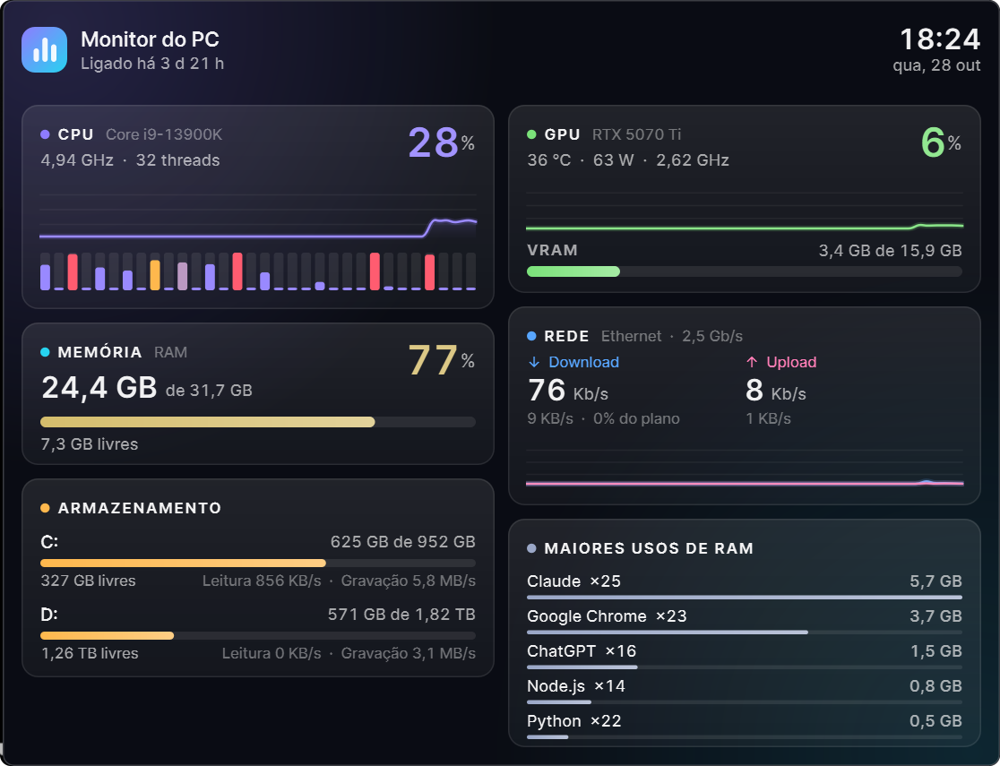
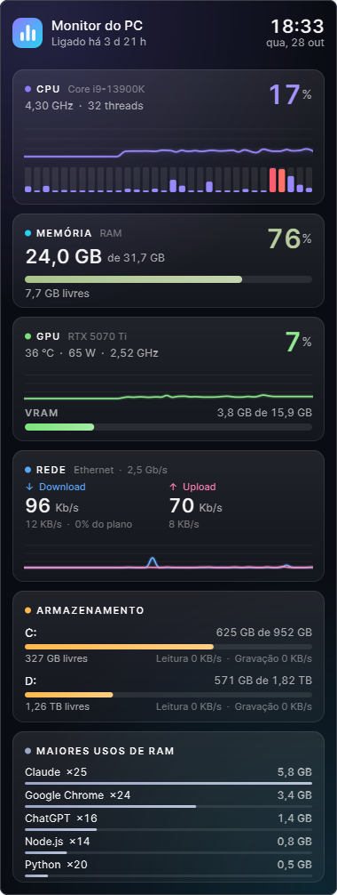

<h1 align="center">GlassPulse</h1>

<p align="center">
  <b>Monitor do PC em vidro acrílico para a área de trabalho do Windows 11.</b><br>
  CPU, memória, GPU NVIDIA, rede e discos em tempo real — bonito, leve e sem poluir a barra de tarefas.
</p>

<p align="center">
  
  
  
  
</p>

<p align="center">
  
</p>

> **English:** GlassPulse is a featherlight, glassy system-monitor widget for the Windows 11 desktop
> (acrylic blur, rounded corners, dark theme). Live CPU / per-core, RAM, NVIDIA GPU (NVML), network and
> disk usage in ~20 MB of RAM and ~0.2 % of total CPU. The interface is in Brazilian Portuguese.

## Destaques

- **Vidro de verdade:** acrílico do Windows 11 (desfoque do que está atrás), cantos redondos do DWM, tema escuro com acentos por categoria e tipografia Inter com números tabulares.
- **Fica na área de trabalho:** atrás de todas as janelas, sem botão na barra de tarefas, fora do Alt+Tab, sem roubar foco. Arraste para posicionar; a posição é salva.
- **Multi-monitor:** escolha o monitor e o canto pelo menu (ou arraste — ele "gruda" nas bordas). Layout em **coluna** (ideal para monitor vertical) ou **painel largo**.
- **Números que batem com o Gerenciador de Tarefas:** usa os mesmos contadores do Windows (PDH) — uso de CPU "Processor Utility", memória "Em uso", rede e atividade de disco.
- **Leve de verdade:** ~20 MB de RAM (≈11 MB na coluna *Memória* do Gerenciador), ~0,2 % da CPU total. Prioridade abaixo do normal, sem timers de 1 ms, e **para de pintar** quando um jogo/app em tela cheia cobre o widget.
- **Animações suaves:** gráficos que deslizam, barras e números que "rolam" a cada amostra e depois o widget fica parado.

### O que mostra

| Bloco | Detalhes |
|---|---|
| **CPU** | uso total, histórico de 1 min, uma barra por núcleo/thread, frequência real |
| **Memória** | usada / total / livre e % |
| **GPU NVIDIA** | uso, VRAM (igual ao `nvidia-smi`), temperatura, potência, clock — via NVML, sem chamar o `nvidia-smi` |
| **Rede** | download e upload em Mb/s e MB/s, histórico, % do seu plano — só adaptadores físicos |
| **Armazenamento** | todos os discos fixos: usado / livre e leitura/gravação ao vivo |
| **Maiores usos de RAM** | por programa (conjunto de trabalho privado, como o Gerenciador) e tempo ligado |

Os números mudam de cor conforme apertam: âmbar acima de ~72 % e coral acima de ~88 %.

<p align="center"></p>

## Instalação

Requisitos: **Windows 11**, **Python 3.12+** (com `pythonw.exe`). Placa NVIDIA é opcional (sem ela, o bloco de GPU some).

```powershell
git clone https://github.com/kaykyoncode/glasspulse.git
cd glasspulse
.\instalar.ps1
```

O `instalar.ps1` instala as dependências **dentro do projeto** (`.libs`, nada global), gera o ícone e cria
os atalhos: um na pasta de inicialização do Windows (para abrir no logon) e um na sua área de trabalho
(ou em `Desktop\05 Atalhos`, se essa pasta existir). Use `-SemInicio` para não iniciar com o Windows.

Para abrir agora: dê dois cliques no atalho **Monitor do PC** ou rode `pythonw monitor_pc.pyw`.

## Uso

| Ação | Como |
|---|---|
| Mover | arraste o widget (posição salva) |
| Monitor / canto / layout / vidro | clique direito no widget ou no ícone da bandeja |
| Travar posição | menu → *Travar posição* |
| Ocultar / mostrar | clique esquerdo no ícone da bandeja |
| Fechar | menu → **Sair** ou `pythonw monitor_pc.pyw --sair` |
| Iniciar com o Windows | menu → *Iniciar com o Windows* |

Configuração em `%APPDATA%\MonitorPC\config.json` (a maior parte pelo menu). Um campo só existe no arquivo:
`"plano_mbps"` — a velocidade contratada, em Mb/s, para o "% do plano" da rede (`0` esconde). Erros vão para `%APPDATA%\MonitorPC\erro.log`.

## Como funciona

- **Métricas:** PDH (`Processor Information`, `Network Interface`, `PhysicalDisk`), NVML por `ctypes` (`nvmlDeviceGetMemoryInfo_v2`, igual ao `nvidia-smi`) e Toolhelp + `PrivateWorkingSetSize` para os processos. `psutil` cobre RAM, discos e o plano B.
- **Janela:** `SetWindowCompositionAttribute` (acrílico) + `DWMWA_WINDOW_CORNER_PREFERENCE`; estilo `WS_EX_TOOLWINDOW | WS_EX_NOACTIVATE`; Z-order no fundo; a área de trabalho (Progman) é a *dona* da janela, para que ela acompanhe o Win+D.
- **Pintura em duas camadas:** fundo + textos são refeitos 1×/s num `QPixmap`; gráficos e barras são desenhados por cima a 25 fps só durante ~0,7 s após cada amostra. Repaint parcial foi descartado: janelas translúcidas com acrílico deixam retângulos escuros.
- **Robustez:** instância única (mutex), watchdog que se relança se o Explorer reiniciar, `--sair` fecha a instância em execução.

Estrutura: `monitor_pc.pyw` (entrada) · `src/monitor/` (`coletores.py`, `widget.py`, `winapi.py`, `app.py`, `config.py`, `icone.py`) · `fontes/` · `ferramentas/gerar_icone.py` · `instalar.ps1`.

## Limitações e ideias

- **Temperatura da CPU não aparece:** no Windows só dá para ler com driver de kernel (ex.: LibreHardwareMonitor, como administrador). Fica como possível extensão opcional.
- GPU: só NVIDIA por enquanto (AMD/Intel Arc seriam um novo coletor).
- Pensado para Windows 11 (acrílico + cantos do DWM). O comportamento com **Win+D** depende da janela ser "dona" do Progman e ainda não foi validado em todas as builds — se o widget sumir nesse atalho, abra uma issue.
- `--teste-topo` (dev) coloca a janela acima das outras, útil para tirar capturas de tela.

## Licença e créditos

Código sob licença [MIT](LICENSE). A fonte [Inter](https://github.com/rsms/inter) (em `fontes/`) segue a
[SIL Open Font License 1.1](fontes/OFL.txt). Interface com [Qt for Python (PySide6)](https://doc.qt.io/qtforpython-6/) — instalado via pip, não redistribuído aqui.
